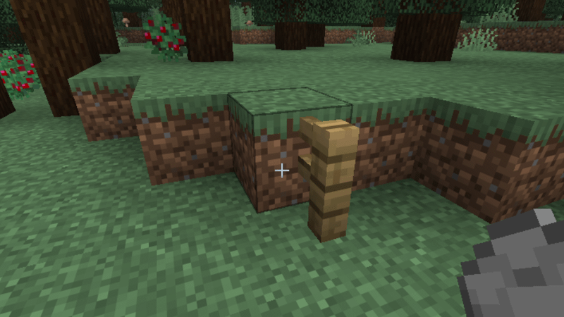

# Convenient Cushions

Cushions are a tad clunky, shall we make them a bit more convenient?

***

### Placing Cushions

When placing cushions, it can be quite tedious having to use snow layers to get cushions placed right where you want
them. Fortunately for you, I've got you covered! With Convenient Cushions, you can place cushions at any Y level to the
nearest 1/16th. This means you can get the same level of precision that snow layers or any other block can give you
while not having to fiddle around with those blocks.

Vanilla does provide a way to achieve similar behavior to this. However that is a bit different, since that allows you
to place cushions at _literally_ any Y level. Meaning your cushion can be placed ever so slightly off from pixel
alignment. Convenient Cushions also solves this by only placing cushions at pixel aligned Y levels.

### Consistent Cushion Breaking

In some cases, the change to how placing cushions works may not be enough. As such, you may still need to use other
blocks to support the cushion temporarily. You may have noticed that sometimes when breaking the block that holds the
cushion in place, some cushions will randomly break before you get a good chance to place down a new block in its place.
This is because vanilla checks every 5 seconds per cushion, and breaks it if it doesn't have support. It's nigh
impossible to predict this. Convenient Cushions changes this behavior, requiring that the cushion be unsupported for
**at least** a full 2 seconds (but may stay for up to 7 seconds) in order for it to break.

### Not Convenient Enough?

Let me know! Feel free to open an issue on [my GitHub](https://github.com/Swedz/Convenient-Cushions) (but please check
it has not been made before), or ask in [my Discord server](https://discord.gg/vNaqDzSNaB)! I'm aware these changes
don't solve all the inconvenience with cushions, so I am open to community feedback.

***

### Wait, 1.21.1? I thought cushions were added in 26.3?

Yes, cushions were added in 26.3. However, I have a 1.21.1 version that is compatible with the cushions added in
[Vanilla Backport by BlackGear](https://www.curseforge.com/minecraft/mc-mods/vanillabackport)!